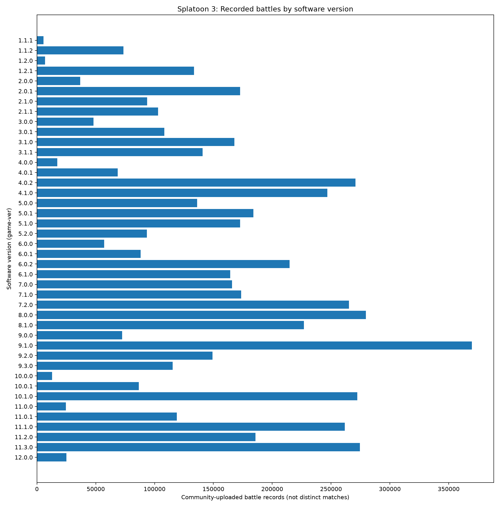
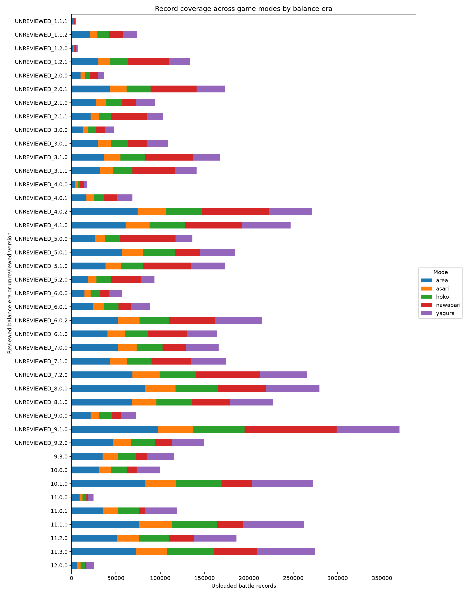
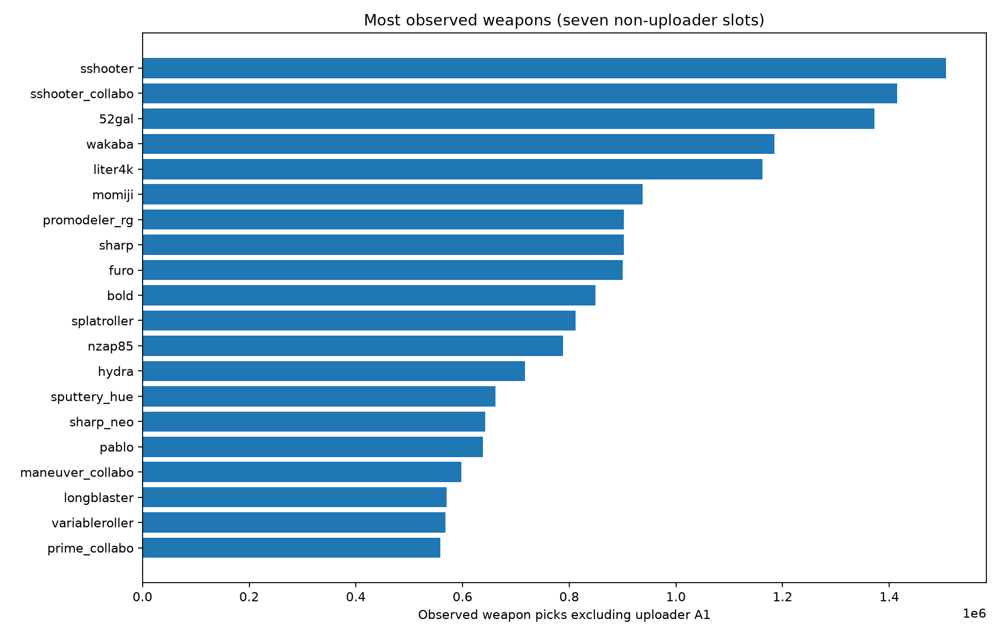

# Initial EDA — Splatoon 3 game-version and balance-patch coverage

**Run type:** COMPLETE archive  
**Records in analysis:** 5,886,306  
**Distinct software versions:** 42  
**Reviewed balance-patch periods with at least one version in data:** 9  
**Earliest observed rotation:** 2022-09-26 00:00:00+00:00  
**Latest observed rotation:** 2026-11-23 22:00:00+00:00

## Key definitions

- A *record* is a stat.ink community-uploaded battle entry. Multiple uploads may describe the same physical battle; totals are not deduplicated Nintendo matches.
- `game-ver` is the recorded software version. It is not synonymous with a balance patch.
- `balance_patch` is curated using official release notes. Unknown versions are labeled `UNREVIEWED_*`, **not** guessed or automatically merged.
- `period` is a 2-hour stage rotation window in UTC, not the exact time the match began. Min/max refer to observed data coverage, **not** official release or sunset dates.
- Non-uploader weapon counts exclude A1, per the stat.ink schema warning; selection bias remains.

## Records and observed date range by software version

| game_version | balance_patch | record_count | official_version_release_date_us | first_observed_period_utc | last_observed_period_utc | distinct_observed_utc_dates |
| --- | --- | --- | --- | --- | --- | --- |
| 1.1.1 | UNREVIEWED_1.1.1 | 5584 |  | 2022-09-26T00:00:00+00:00 | 2022-09-30T00:00:00+00:00 | 5 |
| 1.1.2 | UNREVIEWED_1.1.2 | 73591 |  | 2022-09-30T00:00:00+00:00 | 2022-10-26T00:00:00+00:00 | 27 |
| 1.2.0 | UNREVIEWED_1.2.0 | 6980 |  | 2022-10-26T00:00:00+00:00 | 2022-10-28T04:00:00+00:00 | 3 |
| 1.2.1 | UNREVIEWED_1.2.1 | 133615 |  | 2022-10-28T06:00:00+00:00 | 2022-11-30T00:00:00+00:00 | 34 |
| 2.0.0 | UNREVIEWED_2.0.0 | 36873 |  | 2022-11-30T02:00:00+00:00 | 2022-12-09T00:00:00+00:00 | 10 |
| 2.0.1 | UNREVIEWED_2.0.1 | 172688 |  | 2022-12-09T00:00:00+00:00 | 2023-01-18T00:00:00+00:00 | 41 |
| 2.1.0 | UNREVIEWED_2.1.0 | 93689 |  | 2023-01-18T00:00:00+00:00 | 2023-02-08T22:00:00+00:00 | 22 |
| 2.1.1 | UNREVIEWED_2.1.1 | 102952 |  | 2023-02-09T00:00:00+00:00 | 2023-02-28T00:00:00+00:00 | 20 |
| 3.0.0 | UNREVIEWED_3.0.0 | 48016 |  | 2023-02-28T02:00:00+00:00 | 2023-03-09T00:00:00+00:00 | 10 |
| 3.0.1 | UNREVIEWED_3.0.1 | 108343 |  | 2023-03-09T00:00:00+00:00 | 2023-03-31T00:00:00+00:00 | 23 |
| 3.1.0 | UNREVIEWED_3.1.0 | 167775 |  | 2023-03-31T00:00:00+00:00 | 2023-05-02T14:00:00+00:00 | 33 |
| 3.1.1 | UNREVIEWED_3.1.1 | 140863 |  | 2023-05-02T00:00:00+00:00 | 2023-05-31T00:00:00+00:00 | 30 |
| 4.0.0 | UNREVIEWED_4.0.0 | 17244 |  | 2023-05-31T02:00:00+00:00 | 2023-06-02T04:00:00+00:00 | 3 |
| 4.0.1 | UNREVIEWED_4.0.1 | 68702 |  | 2023-06-02T06:00:00+00:00 | 2023-06-14T00:00:00+00:00 | 13 |
| 4.0.2 | UNREVIEWED_4.0.2 | 270877 |  | 2023-06-14T00:00:00+00:00 | 2023-07-27T00:00:00+00:00 | 44 |
| 4.1.0 | UNREVIEWED_4.1.0 | 246858 |  | 2023-07-27T00:00:00+00:00 | 2023-08-31T00:00:00+00:00 | 36 |
| 5.0.0 | UNREVIEWED_5.0.0 | 136159 |  | 2023-08-31T00:00:00+00:00 | 2023-09-14T22:00:00+00:00 | 15 |
| 5.0.1 | UNREVIEWED_5.0.1 | 183988 |  | 2023-09-15T00:00:00+00:00 | 2023-10-18T00:00:00+00:00 | 34 |
| 5.1.0 | UNREVIEWED_5.1.0 | 172693 |  | 2023-10-18T00:00:00+00:00 | 2023-11-16T00:00:00+00:00 | 30 |
| 5.2.0 | UNREVIEWED_5.2.0 | 93402 |  | 2023-11-16T00:00:00+00:00 | 2023-11-30T00:00:00+00:00 | 15 |
| 6.0.0 | UNREVIEWED_6.0.0 | 57054 |  | 2023-11-30T00:00:00+00:00 | 2023-12-08T00:00:00+00:00 | 9 |
| 6.0.1 | UNREVIEWED_6.0.1 | 88251 |  | 2023-12-08T00:00:00+00:00 | 2023-12-22T00:00:00+00:00 | 15 |
| 6.0.2 | UNREVIEWED_6.0.2 | 214743 |  | 2023-12-22T00:00:00+00:00 | 2024-01-25T00:00:00+00:00 | 35 |
| 6.1.0 | UNREVIEWED_6.1.0 | 164225 |  | 2024-01-25T00:00:00+00:00 | 2024-02-22T00:00:00+00:00 | 29 |
| 7.0.0 | UNREVIEWED_7.0.0 | 165841 |  | 2024-02-22T00:00:00+00:00 | 2024-03-22T00:00:00+00:00 | 30 |
| 7.1.0 | UNREVIEWED_7.1.0 | 173707 |  | 2024-03-22T00:00:00+00:00 | 2024-04-18T00:00:00+00:00 | 28 |
| 7.2.0 | UNREVIEWED_7.2.0 | 265201 |  | 2024-04-18T00:00:00+00:00 | 2024-05-31T00:00:00+00:00 | 44 |
| 8.0.0 | UNREVIEWED_8.0.0 | 279604 |  | 2024-05-31T00:00:00+00:00 | 2024-07-18T00:00:00+00:00 | 49 |
| 8.1.0 | UNREVIEWED_8.1.0 | 226866 |  | 2024-07-18T00:00:00+00:00 | 2024-08-30T00:00:00+00:00 | 44 |
| 9.0.0 | UNREVIEWED_9.0.0 | 72457 |  | 2024-08-30T00:00:00+00:00 | 2024-09-12T00:00:00+00:00 | 14 |
| 9.1.0 | UNREVIEWED_9.1.0 | 369835 |  | 2024-09-12T00:00:00+00:00 | 2024-11-21T00:00:00+00:00 | 71 |
| 9.2.0 | UNREVIEWED_9.2.0 | 149250 |  | 2024-11-21T00:00:00+00:00 | 2025-03-13T00:00:00+00:00 | 113 |
| 9.3.0 | 9.3.0 | 115482 | 2025-03-12 | 2025-03-13T00:00:00+00:00 | 2025-06-12T00:00:00+00:00 | 92 |
| 10.0.0 | 10.0.0 | 12960 | 2025-06-11 | 2025-06-12T00:00:00+00:00 | 2025-06-27T00:00:00+00:00 | 16 |
| 10.0.1 | 10.0.0 | 86652 | 2025-06-26 | 2025-06-27T00:00:00+00:00 | 2025-09-04T00:00:00+00:00 | 70 |
| 10.1.0 | 10.1.0 | 272335 | 2025-09-03 | 2025-09-04T00:00:00+00:00 | 2026-01-29T00:00:00+00:00 | 148 |
| 11.0.0 | 11.0.0 | 24682 | 2026-01-28 | 2026-01-29T00:00:00+00:00 | 2026-02-05T00:00:00+00:00 | 8 |
| 11.0.1 | 11.0.1 | 118905 | 2026-02-04 | 2026-02-05T00:00:00+00:00 | 2026-03-19T00:00:00+00:00 | 43 |
| 11.1.0 | 11.1.0 | 261794 | 2026-03-18 | 2026-03-19T00:00:00+00:00 | 2026-06-11T00:00:00+00:00 | 85 |
| 11.2.0 | 11.2.0 | 185840 | 2026-06-10 | 2026-06-11T00:00:00+00:00 | 2026-08-20T00:00:00+00:00 | 71 |
| 11.3.0 | 11.3.0 | 274629 | 2026-08-19 | 2026-08-20T00:00:00+00:00 | 2026-11-18T00:00:00+00:00 | 91 |
| 12.0.0 | 12.0.0 | 25101 | 2026-11-17 | 2026-11-18T00:00:00+00:00 | 2026-11-23T22:00:00+00:00 | 6 |

## Records by reviewed balance-patch era / provisional version

| balance_patch | game_versions | record_count | official_balance_patch_release_date_us | first_observed_period_utc | last_observed_period_utc |
| --- | --- | --- | --- | --- | --- |
| UNREVIEWED_9.1.0 | 9.1.0 | 369835 |  | 2024-09-12T00:00:00+00:00 | 2024-11-21T00:00:00+00:00 |
| UNREVIEWED_8.0.0 | 8.0.0 | 279604 |  | 2024-05-31T00:00:00+00:00 | 2024-07-18T00:00:00+00:00 |
| 11.3.0 | 11.3.0 | 274629 | 2026-08-19 | 2026-08-20T00:00:00+00:00 | 2026-11-18T00:00:00+00:00 |
| 10.1.0 | 10.1.0 | 272335 | 2025-09-03 | 2025-09-04T00:00:00+00:00 | 2026-01-29T00:00:00+00:00 |
| UNREVIEWED_4.0.2 | 4.0.2 | 270877 |  | 2023-06-14T00:00:00+00:00 | 2023-07-27T00:00:00+00:00 |
| UNREVIEWED_7.2.0 | 7.2.0 | 265201 |  | 2024-04-18T00:00:00+00:00 | 2024-05-31T00:00:00+00:00 |
| 11.1.0 | 11.1.0 | 261794 | 2026-03-18 | 2026-03-19T00:00:00+00:00 | 2026-06-11T00:00:00+00:00 |
| UNREVIEWED_4.1.0 | 4.1.0 | 246858 |  | 2023-07-27T00:00:00+00:00 | 2023-08-31T00:00:00+00:00 |
| UNREVIEWED_8.1.0 | 8.1.0 | 226866 |  | 2024-07-18T00:00:00+00:00 | 2024-08-30T00:00:00+00:00 |
| UNREVIEWED_6.0.2 | 6.0.2 | 214743 |  | 2023-12-22T00:00:00+00:00 | 2024-01-25T00:00:00+00:00 |
| 11.2.0 | 11.2.0 | 185840 | 2026-06-10 | 2026-06-11T00:00:00+00:00 | 2026-08-20T00:00:00+00:00 |
| UNREVIEWED_5.0.1 | 5.0.1 | 183988 |  | 2023-09-15T00:00:00+00:00 | 2023-10-18T00:00:00+00:00 |
| UNREVIEWED_7.1.0 | 7.1.0 | 173707 |  | 2024-03-22T00:00:00+00:00 | 2024-04-18T00:00:00+00:00 |
| UNREVIEWED_5.1.0 | 5.1.0 | 172693 |  | 2023-10-18T00:00:00+00:00 | 2023-11-16T00:00:00+00:00 |
| UNREVIEWED_2.0.1 | 2.0.1 | 172688 |  | 2022-12-09T00:00:00+00:00 | 2023-01-18T00:00:00+00:00 |
| UNREVIEWED_3.1.0 | 3.1.0 | 167775 |  | 2023-03-31T00:00:00+00:00 | 2023-05-02T14:00:00+00:00 |
| UNREVIEWED_7.0.0 | 7.0.0 | 165841 |  | 2024-02-22T00:00:00+00:00 | 2024-03-22T00:00:00+00:00 |
| UNREVIEWED_6.1.0 | 6.1.0 | 164225 |  | 2024-01-25T00:00:00+00:00 | 2024-02-22T00:00:00+00:00 |
| UNREVIEWED_9.2.0 | 9.2.0 | 149250 |  | 2024-11-21T00:00:00+00:00 | 2025-03-13T00:00:00+00:00 |
| UNREVIEWED_3.1.1 | 3.1.1 | 140863 |  | 2023-05-02T00:00:00+00:00 | 2023-05-31T00:00:00+00:00 |
| UNREVIEWED_5.0.0 | 5.0.0 | 136159 |  | 2023-08-31T00:00:00+00:00 | 2023-09-14T22:00:00+00:00 |
| UNREVIEWED_1.2.1 | 1.2.1 | 133615 |  | 2022-10-28T06:00:00+00:00 | 2022-11-30T00:00:00+00:00 |
| 11.0.1 | 11.0.1 | 118905 | 2026-02-04 | 2026-02-05T00:00:00+00:00 | 2026-03-19T00:00:00+00:00 |
| 9.3.0 | 9.3.0 | 115482 | 2025-03-12 | 2025-03-13T00:00:00+00:00 | 2025-06-12T00:00:00+00:00 |
| UNREVIEWED_3.0.1 | 3.0.1 | 108343 |  | 2023-03-09T00:00:00+00:00 | 2023-03-31T00:00:00+00:00 |
| UNREVIEWED_2.1.1 | 2.1.1 | 102952 |  | 2023-02-09T00:00:00+00:00 | 2023-02-28T00:00:00+00:00 |
| 10.0.0 | 10.0.0, 10.0.1 | 99612 | 2025-06-11 | 2025-06-12T00:00:00+00:00 | 2025-09-04T00:00:00+00:00 |
| UNREVIEWED_2.1.0 | 2.1.0 | 93689 |  | 2023-01-18T00:00:00+00:00 | 2023-02-08T22:00:00+00:00 |
| UNREVIEWED_5.2.0 | 5.2.0 | 93402 |  | 2023-11-16T00:00:00+00:00 | 2023-11-30T00:00:00+00:00 |
| UNREVIEWED_6.0.1 | 6.0.1 | 88251 |  | 2023-12-08T00:00:00+00:00 | 2023-12-22T00:00:00+00:00 |
| UNREVIEWED_1.1.2 | 1.1.2 | 73591 |  | 2022-09-30T00:00:00+00:00 | 2022-10-26T00:00:00+00:00 |
| UNREVIEWED_9.0.0 | 9.0.0 | 72457 |  | 2024-08-30T00:00:00+00:00 | 2024-09-12T00:00:00+00:00 |
| UNREVIEWED_4.0.1 | 4.0.1 | 68702 |  | 2023-06-02T06:00:00+00:00 | 2023-06-14T00:00:00+00:00 |
| UNREVIEWED_6.0.0 | 6.0.0 | 57054 |  | 2023-11-30T00:00:00+00:00 | 2023-12-08T00:00:00+00:00 |
| UNREVIEWED_3.0.0 | 3.0.0 | 48016 |  | 2023-02-28T02:00:00+00:00 | 2023-03-09T00:00:00+00:00 |
| UNREVIEWED_2.0.0 | 2.0.0 | 36873 |  | 2022-11-30T02:00:00+00:00 | 2022-12-09T00:00:00+00:00 |
| 12.0.0 | 12.0.0 | 25101 | 2026-11-17 | 2026-11-18T00:00:00+00:00 | 2026-11-23T22:00:00+00:00 |
| 11.0.0 | 11.0.0 | 24682 | 2026-01-28 | 2026-01-29T00:00:00+00:00 | 2026-02-05T00:00:00+00:00 |
| UNREVIEWED_4.0.0 | 4.0.0 | 17244 |  | 2023-05-31T02:00:00+00:00 | 2023-06-02T04:00:00+00:00 |
| UNREVIEWED_1.2.0 | 1.2.0 | 6980 |  | 2022-10-26T00:00:00+00:00 | 2022-10-28T04:00:00+00:00 |
| UNREVIEWED_1.1.1 | 1.1.1 | 5584 |  | 2022-09-26T00:00:00+00:00 | 2022-09-30T00:00:00+00:00 |

## Key charts







## Data-quality checks

```json
{
  "records_total": 5886306,
  "period_missing_or_invalid": 0,
  "version_missing_or_invalid": 0,
  "win_missing_or_invalid": 0,
  "unreviewed_version_records": 4507926
}
```

## Limitations / next work

1. Review and extend `config/version_to_balance_patch.csv` for older versions before cross-patch balance conclusions.
2. Review distribution of observation counts per patch and mode before modeling. Sparse periods should be pooled only when substantively justified.
3. `period` covers 2-hour rotations: do not use it to claim exact game-start timestamps.
4. Volunteer samples are nonrandom and uploads may duplicate a single match. Calculated 'win rates' describe observed picks only; they are not causal weapon-strength estimates.
5. The parquet extraction preserves all original columns for later Spark analysis; move it to S3 or process in Spark when starting the distributed processing milestone.

**Sources:** stat.ink CSV schema: https://github.com/fetus-hina/stat.ink/wiki/Spl3-%EF%BC%8D-CSV-Schema-%EF%BC%8D-Battle  
Nintendo update history: https://en-americas-support.nintendo.com/app/answers/detail/a_id/61257/  
Current Nintendo releases: https://en-americas-support.nintendo.com/app/answers/detail/a_id/59461/
